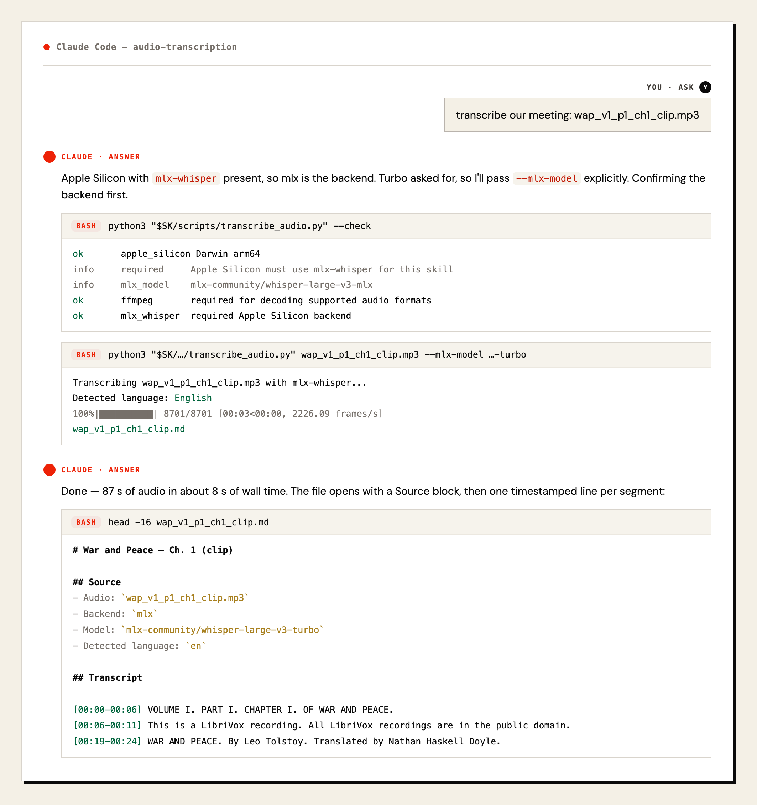
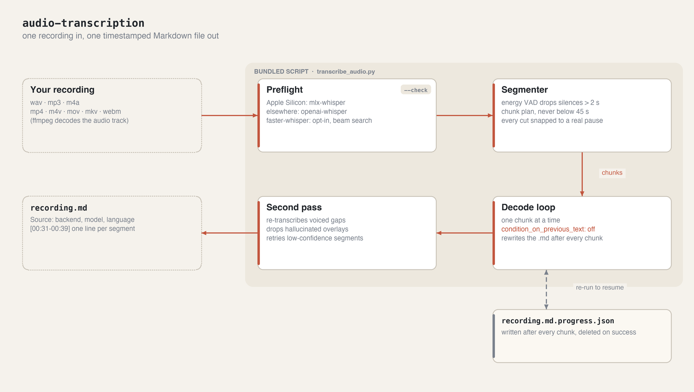

# 🎙️ audio-transcription

audio-transcription runs Whisper over your local audio and video files and hands back
timestamped Markdown you can read and grep, so the two minutes you need out of an hour of
recording become a search instead of a re-listen. It picks the fastest Whisper build for your
hardware — `mlx-whisper` on Apple Silicon, `openai-whisper` elsewhere — and ffmpeg pulls the
audio track out of video. A single file or a whole folder; an opt-in `faster-whisper` for
noisy, accented or far-mic audio.

## 🎬 Demo

The dependency check, a plain-language request, 87 seconds of audio transcribed in about 8, and
the Markdown that came out.



## ⚙️ How it works



Whisper fails in a handful of predictable ways, and each stage exists to shut one down:

- **Preflight** picks the backend from your platform rather than the flag you passed, and refuses
  the slower, less accurate build on Apple Silicon.
- **The segmenter** keeps chunks long enough for context, skips the long silences where Whisper
  hallucinates, and moves every cut onto a real pause so no word is split.
- **The decode loop** runs one chunk at a time with the repetition trap disabled, and rewrites the
  Markdown after each chunk — so an interrupted job resumes by re-running the same command, no flag.
- **A second pass** checks the finished transcript back against the audio: it re-transcribes voiced
  gaps, drops hallucinated overlays, and re-runs the segments Whisper's own confidence flags.

Every number behind these defaults comes from the harnesses in [`evals/`](../../evals), not
intuition.

## 📦 Install in Claude Code

```
/plugin marketplace add dmitry-do/ai-toolkit-public
/plugin install audio-transcription@ai-toolkit-public
```

## 🌐 Claude Web

Build the plugin zip with `scripts/package-plugin.sh audio-transcription` and upload it in **Customize → Plugins**. You upload
the recording there. The claude.ai sandbox is a Linux CPU machine with no MLX, so the skill installs
the portable `openai-whisper` backend (after asking) and uses a smaller model, which is slower and
less accurate than the local default. If the sandbox can't install packages, the skill says so and
the recording needs Claude Code.

Mine, MIT-licensed (see the root [LICENSE](../../LICENSE)).
